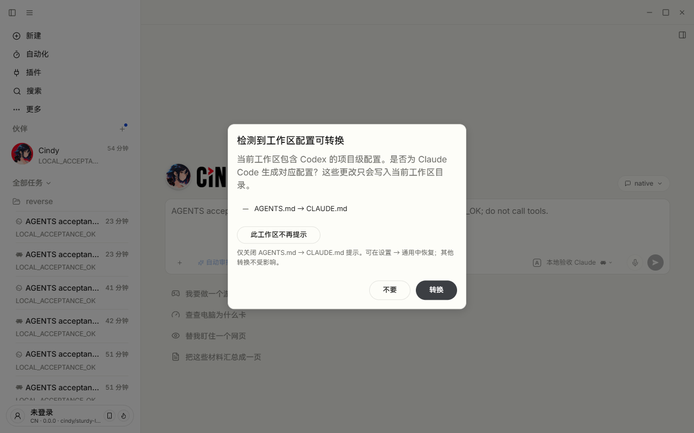
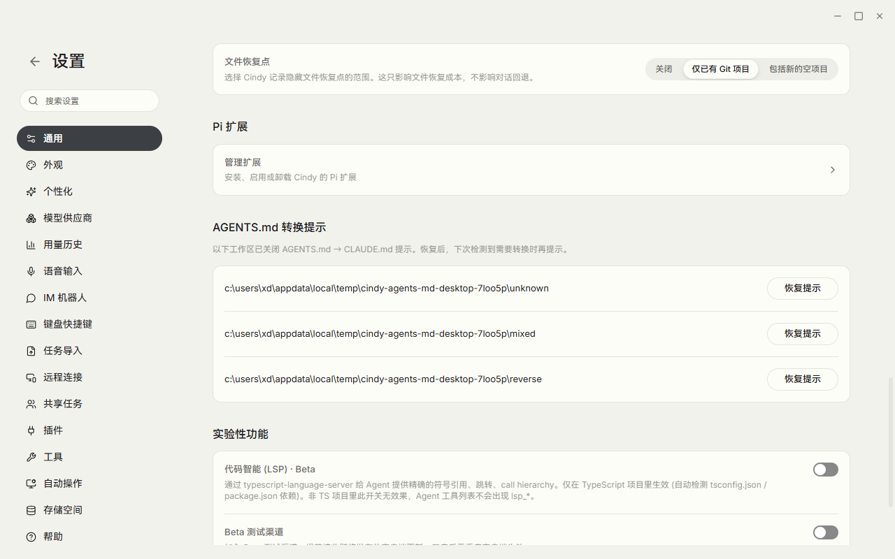
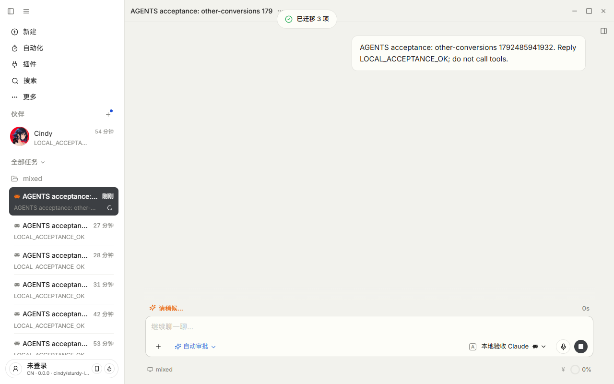

# PR #6522：显式工作区选择验收

结论：收窄后的 `b978633192a62c396046463106bbb704e2cfc1d0` 已通过完整 Desktop 真实入口验收。**自动能力判断已取消**；历史 c9e7315 报告中的自动跳过结论不再代表本 PR 的最终行为。

## 范围与环境

2026-10-20，Windows x64，完整 Electron 42.11.12 开发应用、中文 Light。实际执行 CLI `--version`：Claude Code 2.1.296、Codex 0.159.2。

使用专用 `agents-md-acceptance` 本地未登录 profile，通过仓库命令 `corepack pnpm restart:desktop:remote --region=cn --isolated=agents-md-acceptance --isolated-auth` 启动，返回 `DESKTOP_DEV_VERDICT=ready`。CDP 监听 PID 与启动器报告一致，连接脚本拒绝云端账号或错误构建。

正式操作使用真实“新建 → 项目选择器 → 模型选择器 → 发送”、真实弹窗和“菜单 → 设置 → 通用”。没有用直接偏好写接口代替按钮，没有替换 detector、IPC 或组件。真实 CLI 连接 `127.0.0.1:52980` 的无鉴权测试后端，只返回固定 `LOCAL_ACCEPTANCE_OK`；不消耗真实模型额度，不代表模型质量验收。只记录请求元数据，不保存请求正文或鉴权值。

## 结果

| 操作 | 观察 |
| --- | --- |
| 未作选择的新建任务 | 原有文件条件满足时出现提示；普通取消后真实 CLI 收到本地后端回复。CLI 版本不再参与 Cindy 的是否提示决策 |
| 普通取消 / Esc | 不保存偏好，下次新建再次提示 |
| 此工作区不再提示 | 真实按钮保存选择，未生成 CLAUDE.md，AGENTS.md 原文不变 |
| 另一目录 | 仍然提示，已关闭目录不受影响 |
| agents/hooks/MCP | 关闭 AGENTS 项后剩余三项继续可转换；实际点击转换显示“已迁移 3 项”，三个目标配置均生成，CLAUDE.md 未生成 |
| 反向转换 | 同目录已保存正向关闭选择，Codex 的 CLAUDE.md → AGENTS.md 提示仍出现 |
| 转换失败 | 检测后暂时移走测试源文件，转换失败没有保存关闭选择；随后恢复源文件 |
| 真正重启 | 仓库包装命令停止旧进程并重新启动，同 profile 的主进程 **32724 → 23932**；再次新建跳过已关闭项并收到本地回复 |
| 完整设置恢复 | 点击指定目录恢复，下次新建重新提示；其余目录的选择仍保留 |
| 恢复最后一项 | 区块消失、偏好文件被删除；验收结束无剩余关闭选择 |

源指令内容已逐个核对未被改写；反向测试的文件切换只发生在系统临时目录夹具内。保存失败反馈及并发/目录隔离等由生产 store/IPC 和真实 hook+dialog 定向测试补充。

## 证据与限制

- [机器结果](verified-desktop-results.json) 包含每一步、构建、真实 PID、源文件及偏好清理断言。
- 来源脚本：[真实入口操作](full-desktop-acceptance.mjs)、[隔离连接护栏](full-desktop-connection.mjs)、[本机测试后端](full-desktop-local-provider.mjs)。夹具及供应商沿用先前专用验收 profile；没有用户账号、密钥或项目数据。
- 未验证 macOS、真实外部模型供应商、分发包；单页中文 Light/Dark 另行验证并目检总览。
- 验收结束已通过设置恢复所有偏好，并关闭本次验收应用和本地测试后端。正式安装版 `C:\Program Files\Cindy\Cindy.exe` PID 3120 保持运行。本次未构建安装包、未安装系统编译工具。
- 本报告只证明上述最终显式选择范围；不替代维护者正式 Approve 或 CI。
