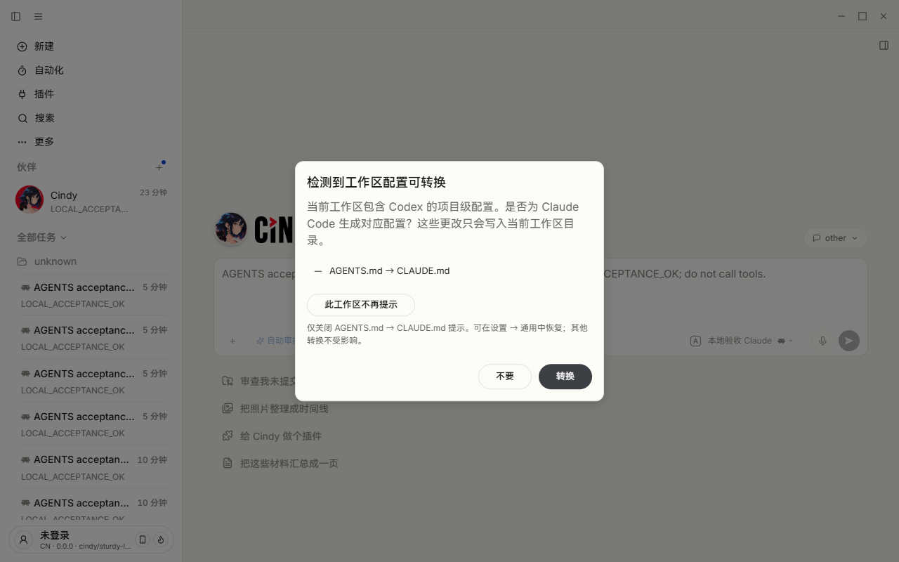
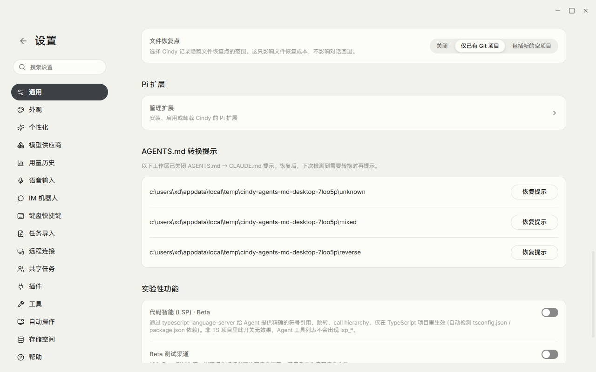
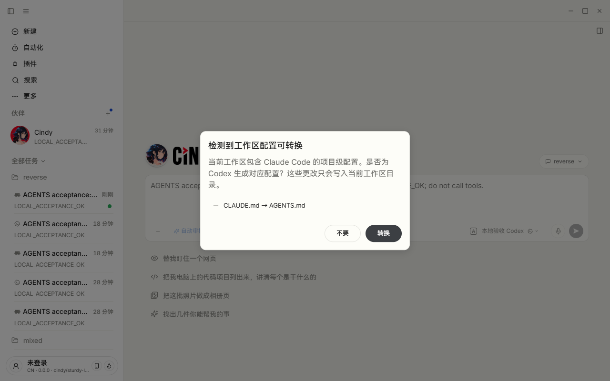
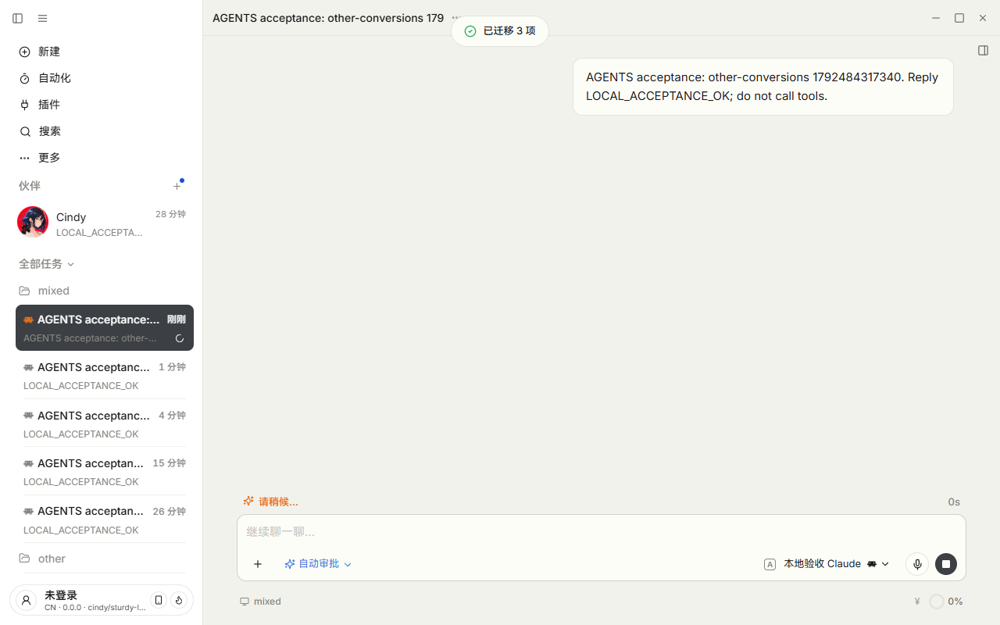
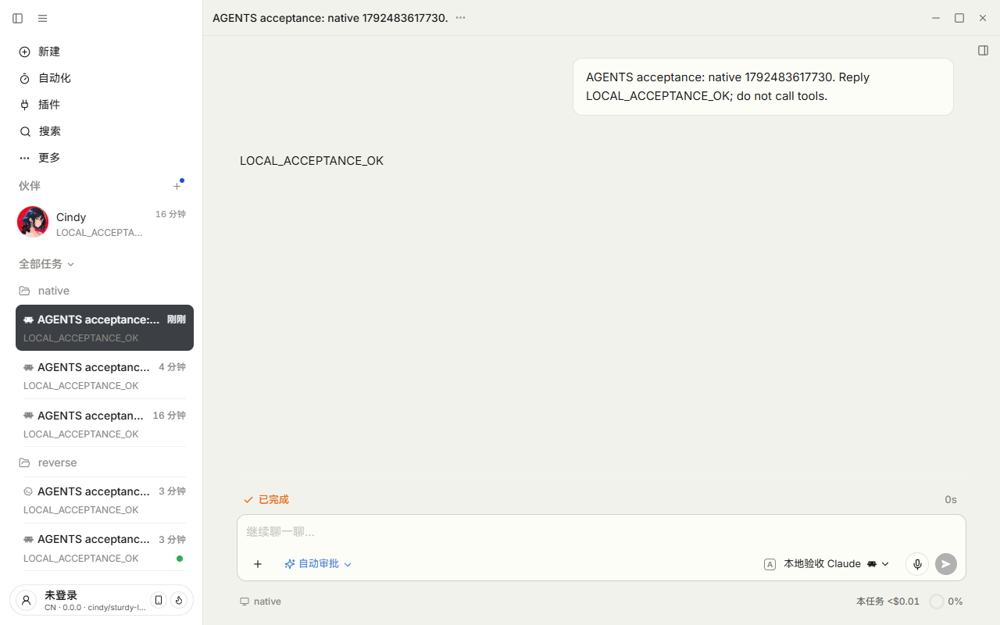

# PR #6522：完整 Desktop 入口验收

结论：已按 [#6523](https://github.com/makecindy/cindy/issues/6523) 补齐 Windows 完整 Desktop 新建入口、真实进程重启和完整设置页的验收，未发现需要修改产品代码的偏差。PR head 仍为 `c9e7315f4f649e1d519b9049a8e53e38b770d44d`。

本次是**完整开发应用 → 真实 CLI → 本机测试后端**的贯通验收。测试后端返回固定文本 `LOCAL_ACCEPTANCE_OK`，不调用真实模型，也不把这个结果描述为真实供应商或模型推理质量验收。

## 运行环境与隔离

- 日期：2026-10-20；Windows x64，中文界面、Light 模式。
- 完整应用：Electron 42.11.12，界面版本 `0.0.0 · cindy/sturdy-lederberg@c9e7315`。Main、preload、Renderer、实际新建页面和设置页面均为当前 PR 的生产实现，没有挂单页 fixture，也没有替换迁移函数或 IPC。
- Claude Code：实际执行 `claude.exe --version` 为 `2.1.296 (Claude Code)`；实际子进程来自本 worktree 的受管 CLI。反向提示用 Codex `0.159.2`。
- 专用 profile：`Cindy-dev2-agents-md-acceptance`。启动前为未登录状态，验收采用本地模式，不使用 Cindy 云端账号。
- 启动命令：`corepack pnpm restart:desktop:remote --region=cn --isolated=agents-md-acceptance --isolated-auth`，另设置本次独立 CDP 端口。启动返回 `DESKTOP_DEV_VERDICT=ready`，并等待工作台相关 IPC 就绪。
- 最终全界面轮次的真实重启：主进程 **37036 → 37472**；相同命名 profile、相同 commit，非 Renderer reload。CDP 监听进程与启动器报告的 PID 一致。
- 没有构建或安装分发包，没有安装 MSVC/Rust，没有替换或重启 `C:\Program Files\Cindy` 的正式实例。

## 夹具与证据边界

准备阶段创建专用本地 profile、通过真实供应商 API 配置一个 `auth:none` 的回环供应商，并在系统临时目录创建测试项目。模型路线只指向 `127.0.0.1`，未使用真实 API key。正式验收阶段通过应用的**新建按钮、项目选择器、模型选择器、发送按钮、迁移弹窗及设置控件**操作，不直接写草稿状态或调用偏好写接口代替按钮。

“能力未知”夹具是在测试项目中放置无法解析的 `.claude/settings.json`；实际 CLI 版本仍是 2.1.296，检测器因不能确认有效配置而保留提示。没有改用户的全局 Claude 配置，也没有改 runtime pin。

本地后端只记录时间、请求路径、模型名、是否带鉴权头，以及是否出现指定 AGENTS 夹具标记的布尔值，不保存请求正文、system prompt 或头部值。观察到真实 CLI 请求包含 `# native acceptance fixture` 标记；记录的测试请求均未带鉴权头。

## 验收结果

| 要求 | 完整应用中的操作与观察 | 结果 |
| --- | --- | --- |
| 原生读取成立时跳过 | 新建 → 选择 `native` 项目和本地 Claude 模型 → 发送；无转换弹窗，任务创建并在当前消息流显示本地响应；上游请求出现 AGENTS 夹具标记 | 通过 |
| 能力未知时保留 | 选择带不可解析设置的项目，从真实发送入口触发；显示 AGENTS.md → CLAUDE.md 及“不再提示”按钮 | 通过 |
| 普通取消 / Esc 不持久化 | 普通取消后再次新建发送仍提示；Esc 后也未保存关闭选择 | 通过 |
| 主动关闭后重启仍生效 | 点击真实“不再提示”，完成落盘；终止并重新启动完整 Desktop，PID 改变；同目录再次新建发送不再出现该项 | 通过 |
| 完整设置恢复后重新检测 | 应用菜单 → 设置 → 通用 → 指定目录“恢复提示”；只删除该目录覆盖，其他目录仍保留；该未知能力目录下次发送再次提示 | 通过 |
| 恢复不强制产生多余提示 | 通过夹具把有效配置恢复为可确认原生支持，再在完整设置页恢复该目录；下次新建仍跳过 AGENTS 转换并完成本地响应 | 通过 |
| 其他目录独立 | 一个目录关闭后，另一目录仍出现提示，后者普通取消不改变前者偏好 | 通过 |
| 反向独立 | 同一物理目录已有正向关闭选择，夹具切为仅有 CLAUDE.md，再通过模型选择器选 Codex；仍显示 CLAUDE.md → AGENTS.md | 通过 |
| agents/hooks/MCP 不被屏蔽 | 四项同屏时关闭 AGENTS 项，其他三项仍显示；另用有效无副作用夹具实际点击“转换”，提示“已迁移 3 项”，并检查 `.claude/agents/acceptance.md`、`settings.json` 的 hooks、`.mcp.json` 均生成，CLAUDE.md 未生成 | 通过 |
| 转换失败不保存关闭选择 | 检测后暂移走测试源文件，再点击转换，真实转换器报读取失败；界面报告失败 1 项，未写关闭偏好，随后恢复测试源文件 | 通过 |
| 恢复入口按需显示 | 从完整设置页恢复最后一项后，恢复区块消失，偏好 JSON 文件删除而非写入默认快照 | 通过 |

“不再提示”、取消和恢复均没有改写测试指令原文。其他三种转换只有在后续单独点击“转换”时生成对应目标配置。测试结束时通过完整设置页恢复了全部测试偏好。

## 截图

### 真实新建入口：未知能力保留提示

### 完整设置 → 通用：逐目录恢复

### 反向提示仍然出现

### 其他三种迁移实际完成

### 原生支持：真实任务消息流收到本地响应

## 尚未验证与流程状态

- 没有验证真实外部模型供应商、推理质量、macOS 或 packaged smoke；这些不混入本次通过结论。
- “能力未知”本次通过不可解析配置触发；未知/旧 CLI 版本分支仍由已有定向测试覆盖，未更换安装 CLI 制造该条件。
- 本次完整流程只跑 Windows / 中文 / Light；此前五语言、双主题单页组合验证仍是独立证据。
- 本次仅补验收材料，不产生产品代码修改。维护者确认门（product / rules / arch）仍须维护者在 PR 上正式 **Approve**，普通评论或本报告不替代批准。

机器记录：[verified-desktop-results.json](verified-desktop-results.json)。执行辅助脚本另存为验收来源材料；它们含本次固定的临时目录和端口，不是通用测试工具，也不进入产品代码。

来源材料：[界面验收脚本](full-desktop-acceptance.mjs)、[本地响应后端](full-desktop-local-provider.mjs)、[实例身份核对](full-desktop-connection.mjs)、[隔离数据初始化](full-desktop-bootstrap.mjs)。
