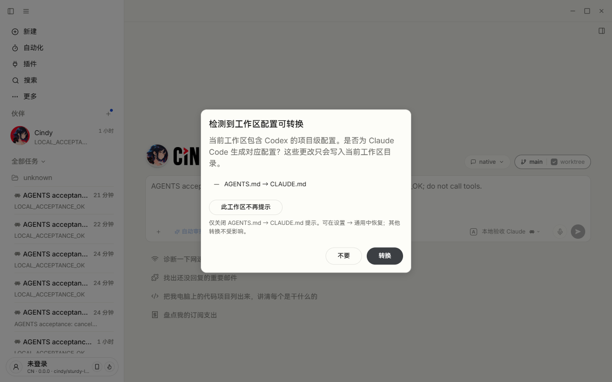
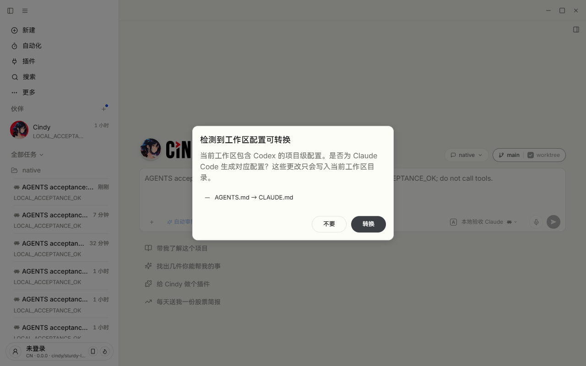
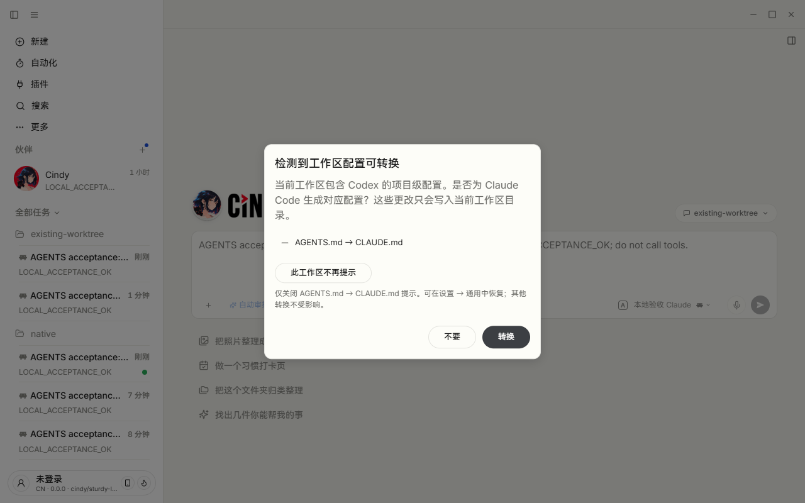

# PR #6522：自动新建 worktree 偏好绑定修复

结论：Codex P1 属实，已在完整 Desktop 复现并修复。提交 `2b09e30f76d26d50e00cf504fbe3f8b901d0556a`，jaja DCO 签署，正常追加到原分支。

## 复现与最小修复

旧提交 `b978633192a6` 的新建页在真正创建 worktree 前检测基础仓库。启用 worktree 后点击「此工作区不再提示」，真实保存列表出现了基础仓库目录，证实会误影响基础仓库和后续新 worktree。

采用审查建议中的最小方案：该创建前弹窗保留原有转换/取消流程，但不读基础仓库的提示偏好，也不提供持久关闭选项。没有延后创建、改导航生命周期或加回能力判断。已有实际工作目录仍可独立保存和恢复。仅为现有 detect IPC 增加默认兼容的偏好读取参数，并将无持久目标的弹窗回调显式设为 null。

## 验证

- 真实提交回调、主进程 IPC、hook/dialog 回归先红后绿。8 文件 106 项定向测试通过（包括既有流程测试，非新增 106 项）；Desktop typecheck 通过，test-hygiene、文档检查、5 个 DCO 提交通过。
- 改写测试单文件 Vitest 耗时：发送回调 4.44 秒；偏好/IPC 0.427 秒；hook/dialog 1.12 秒。初次类型检查发现测试参数断言类型问题，修正后通过。
- 中文 Light/Dark 单页覆盖创建前弹窗、普通选择、混合项、窄窗口和恢复列表；12 个组合通过，已目检两张 overview 并发布。
- 完整 Desktop：Windows x64 / 中文 Light / Electron 42.11.12 / Claude Code 2.1.296，独立 `agents-md-acceptance` 未登录 profile。真实 CLI 只连接本机无鉴权后端，固定回复不代表真实模型质量。
- 修复前 PID 38460；修复版本通过仓库 restart 命令启动，PID 38300，`DESKTOP_DEV_VERDICT=ready`。使用真实新建、项目/模型选择器、worktree 开关、发送、弹窗和完整设置页；未替换检测器/IPC，也不以偏好写接口代替按钮。

| 真实入口步骤 | 结果 |
| --- | --- |
| 基础仓库已有关闭选择，再开启自动 worktree 创建 | 仍提示，只有原有转换/取消按钮；取消后实际创建新 worktree 并收到 CLI 回复，未写入新的偏好 |
| 原生文件夹选择器选一个已有用户 worktree | 可以显式关闭，保存该物理目录；基础仓库偏好仍独立保留 |
| 设置恢复基础仓库 | 基础仓库普通新建重新提示，已有 worktree 仍保持关闭 |
| 设置恢复已有 worktree | 重新提示；最后一个 override 删除，偏好文件移除 |

Cindy 托管的 `.cindy-worktrees` 路径在新建页会由既有 `normalizeDraftWorkingDir` 规则折回基础项目，且不进入最近项目列表。本次没有绕过或修改该规则；“已有 worktree”验证使用系统临时目录下用户自建的独立 Git worktree，并通过真实 Windows 文件夹对话框选择。该对话框自动化仅定位隔离应用 PID 及测试目录，没有替换宿主 API。

验收脚本曾因路径斜杠、最近列表假设和路由切换时机失败；修正脚本后重跑上述步骤通过，不把这些失败算作产品通过证据。

## 截图

修复前：自动 worktree 创建前错误提供持久关闭选项。

修复后：基础仓库已有关闭偏好，仍显示原有转换/取消。

用户已有 worktree：恢复后重新提示且可按实际目录保存。

## 证据与边界

[机器结果](worktree-preference-results.json)；执行脚本为同目录 `migration-worktree-acceptance.mjs`、隔离连接护栏与原生目录选择辅助脚本。未验证 macOS/安装包/外部模型供应商，未改正式安装版。

测试偏好已全部通过设置恢复，验收应用与回环后端已关闭；正式 Cindy PID 3120 保持运行。此 P1 修复不代表维护者已接受收窄范围，也不代表原“能力成立自动跳过”的验收分支通过。范围确认、CI 与正式 Approve 仍按原流程。
